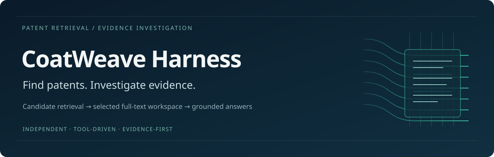
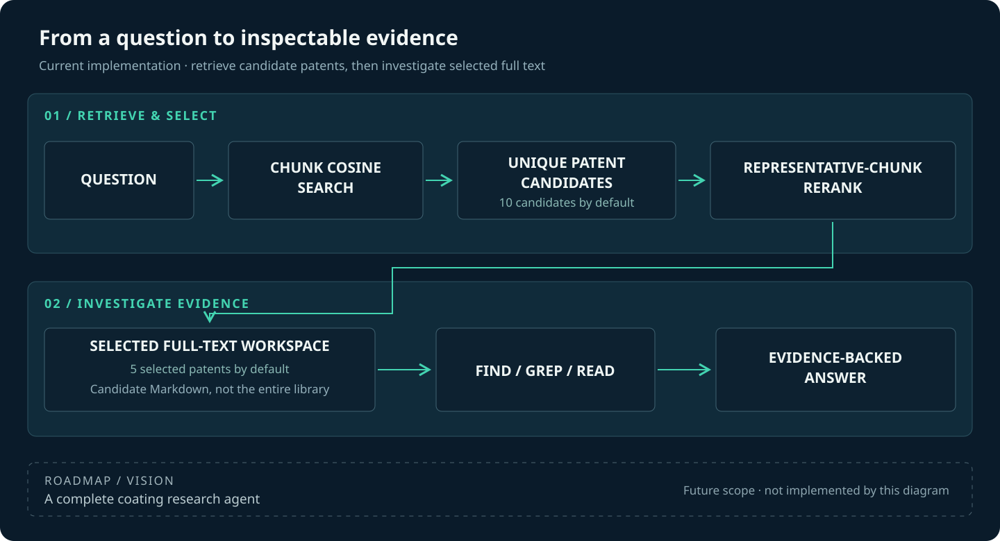
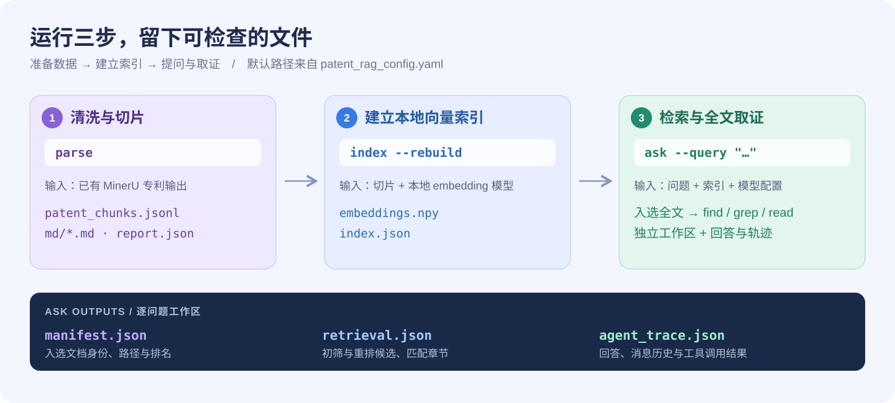

# CoatWeave Harness

**用专利切片找到相关文档，再用全文工具逐段查证涂料研究中的证据。**

*Use chunks to find patents. Use full-text tools to investigate evidence.*

<p align="center"></p>

[快速开始](#快速开始先体验离线工具) · [真实语料运行](#使用自己的专利与模型) · [工具接口](docs/TOOLS.md) · [离线示例](examples/README.md) · [分支导航](#分支与相关项目) · [路线图](docs/ROADMAP.md)

配方、测试方法和性能结果，可能分散在同一篇专利的不同章节。只找到一小段匹配文字，往往还不足以解释实验结果。本项目把这件事分成两步：先找到相关专利，再让模型调用工具，继续检查入选专利的完整清洗文本。

例如，你可以问：**“哪些实施例报告了耐候性能？测试条件是什么？”** 系统先筛选专利，再围绕配方、试验条件和结果跨章节查找，按提示词要求组织带行号引用的回答。引用是否充分支持结论，仍需要核查。

当前 `main` 提供 **Python 命令行检索与取证基础层**。更广泛的涂料研究 Agent（能围绕任务规划并调用工具的程序）是项目方向；Pi Web 服务位于独立特性分支，见[分支导航](#分支与相关项目)。

## 从“命中片段”走向“检查全文”

<p align="center"></p>

图示依据当前 Python 代码绘制。默认配置先选最多 **10 篇不同专利**，再重排保留最多 **5 篇**；这些是专利数量，可以修改。重排依据是标题与代表性切片，随后工具可以读取入选专利中从未命中过的章节。

| 你要做什么 | main 已有的能力 | 对应位置 |
|---|---|---|
| 整理已有专利解析结果 | 读取 MinerU JSON，支持 Markdown 回退；清洗文本、按章节切片 | [解析器](patent_coating/patent_rag_parser.py) |
| 从语料中发现相关专利 | 本地 embedding（把文本转成数值向量）与 NumPy 精确余弦搜索，按公开编号聚合 | [向量索引](patent_coating/search/embedding_index.py) |
| 缩小调查范围 | reranker（对候选重新打分的模型）比较标题与代表性切片 | [检索链路](patent_coating/search/agentic_retrieval.py) |
| 在入选全文中找证据 | `find` 找文件、`grep` 找关键词、`read` 读带行号的上下文 | [工具契约](docs/TOOLS.md) |
| 回看模型做了什么 | 流式工具调用、重试、轮次与输出预算、逐问题工作区和 JSON 轨迹 | [运行时](patent_coating/search/agent_runtime.py) |

这些文件工具是 Python 函数，不需要模型执行 shell。工具只调查已选入工作区的清洗文本；模型目前不能自行扩大候选专利范围。

## 快速开始：先体验离线工具

需要 **Python 3.10+**。从仓库根目录执行：

```bash
git clone git@github.com:Nathan10969/coat_weave_harness.git
cd coat_weave_harness
python -m venv .venv
source .venv/bin/activate
python -m pip install numpy PyYAML python-dotenv
python -m pip install --no-deps -e .
coat-weave-harness --help
```

Windows PowerShell 的激活命令为 `.venv\Scripts\Activate.ps1`。这一套轻量安装足够查看帮助、使用文件工具和运行现有离线测试；真实 embedding 与问答还需要下一节的完整依赖和模型。

[离线示例](examples/README.md)使用一份明确标注的虚构专利文本，把配方、测试方法和结果分放在不同章节。下面的手动操作无需 GPU、模型或付费 API：

```python
from pathlib import Path
from patent_coating.search.agentic_retrieval import SandboxFileTools

tools = SandboxFileTools(Path("examples/synthetic_workspace"))
print(tools.file_read("manifest.json"))
print(tools.file_find("docs/**/*.md"))
print(tools.file_grep("Sample A|Demo-UV|gloss", regex=True))
print(tools.file_read("docs/SYNTHETIC-A.md", start_line=5, end_line=22))
```

`manifest.json` 列出可调查的文档；`grep` 返回匹配位置；`read` 展开周围文字。这展示文件工具的确定性行为，示例内容不代表真实专利或科学结论。

如需在自己的环境中检查现有离线测试：

```bash
python -m unittest discover -s patent_coating/tests -v
```

Windows 的路径逃逸测试需要创建符号链接的权限。测试与仓库的 [Linux 离线 CI 配置](.github/workflows/offline-tests.yml)检查工程行为；它们不评价检索召回率或科学回答质量。

## 使用自己的专利与模型

### 1. 安装完整依赖

在已激活的 Python 环境中运行：

```bash
python -m pip install -e .
cp patent_coating/.env.example patent_coating/.env
```

完整安装包含 PyTorch、Transformers、Sentence Transformers 和 OpenAI 客户端。你需要自行准备 MinerU 输出、本地 embedding 与 reranker 模型，以及支持工具调用的 OpenAI 兼容模型服务。仓库不附带真实语料、模型权重或运行记录。

### 2. 配置数据、模型与服务

修改 [patent_rag_config.yaml](patent_coating/patent_rag_config.yaml)：

| 配置项 | 你需要填写什么 |
|---|---|
| `paths.mineru_root` | 你已有的 MinerU 专利输出目录；本项目消费解析结果，不运行 OCR 引擎 |
| `paths.parsed_dir` / `index_dir` / `workspace_root` | 清洗文本、向量索引和逐问题工作区的保存位置 |
| `models.embedding_path` / `reranker_path` | 自己准备的本地模型路径；建议使用绝对路径 |
| `models.device` / `dtype` | 与硬件和模型匹配的设备与数值类型；示例是 `cuda` / `bfloat16` |
| `models.llm_base_url` / `llm_model` | 你使用的工具调用模型服务地址与模型名 |
| `models.api_key_env` / `paths.env_file` | 密钥的环境变量名与本地环境文件位置；实际密钥仅写入本地 `.env` |
| `retrieval.candidate_patents` / `final_patents` | 初筛与最终入选专利数；默认 `10` / `5` |

`paths.*` 中的数据与环境文件路径相对**配置文件所在目录**解析。模型路径直接传给模型库；沿用示例的相对模型路径时，请从仓库根目录运行。示例服务配置仅作格式参考，需要你确认自己的服务可用性与兼容性。

### 3. 解析、建索引、提问

<p align="center"></p>

```bash
coat-weave-harness parse
coat-weave-harness index --rebuild
coat-weave-harness status
coat-weave-harness ask --query "哪些实施例报告了耐候性能？测试条件是什么？"
```

| 命令 | 做什么 |
|---|---|
| `parse` | 清洗 MinerU 结果并生成章节切片与全文 Markdown |
| `index --rebuild` | 重新计算切片向量并建立本地索引 |
| `build --rebuild` | 连续执行解析与索引构建 |
| `status` | 检查语料数量与索引一致性；它不验证模型服务连通性或回答质量 |
| `ask --query "…"` | 检索、重排、准备全文工作区并进入工具调用循环 |

使用自己的配置文件时，把全局参数 `--config` 放在子命令之前：

```bash
coat-weave-harness --config /absolute/path/my_config.yaml ask \
  --query "Which examples report weathering performance, under what conditions?" \
  --show-tool-output
```

`ask` 可用 `--trace /absolute/path/trace.json` 指定轨迹文件。所有命令也可写成 `python -m patent_coating.patent_rag_app ...`。历史 shell 启动器仍在仓库内，使用它需要另行配置 Conda 环境。

真实运行会加载本地模型，需要匹配的计算资源。`ask` 会把问题和候选专利文本发送给配置的提供商，可能产生费用；运行前请确认语料使用权限与服务的数据策略。

## 每次提问都能留下什么

每个问题会创建独立工作区，复制入选专利的完整清洗 Markdown，并写入：

| 文件 | 用途 |
|---|---|
| `manifest.json` | 文档身份、路径和排名元信息，告诉工具当前能调查哪些全文 |
| `retrieval.json` | 初筛候选、重排候选和匹配章节摘要，便于检查为什么选中这些专利 |
| `agent_trace.json` | 最终回答、消息历史及工具参数和结果；可用 `--trace` 改变位置 |

索引还会记录源切片与向量文件的指纹、模型标识和序列长度，拒绝复用过期索引。它检查的是文件与配置一致性，不证明语义正确，也没有为全文 Markdown 额外绑定内容哈希。轨迹可能包含问题与专利正文，请按自己的数据权限保存。

## 分支与相关项目

| 入口 | 范围与状态 |
|---|---|
| **`main` · 当前文档** | Python CLI、NumPy 本地检索、入选专利全文工具、逐问题工作区与轨迹 |
| **[`feat/public-pi-harness`](https://github.com/Nathan10969/coat_weave_harness/tree/feat/public-pi-harness)** | 增加独立的 Pi SDK 服务层：原生会话、HTTP/SSE、有限的 completion 兼容接口，以及 FastAPI/Milvus 专利工具后端；配置与命令见[该分支的 Pi 指南](https://github.com/Nathan10969/coat_weave_harness/blob/feat/public-pi-harness/pi-harness/README.md) |
| **[`coat-weave`](https://github.com/Nathan10969/coat-weave)** | 相关涂料研究源码项目，包含知识抽取、服务侧检索与 embedding 流程；两者可以分别阅读和使用 |

`main` 不包含 `pi-harness/`，也不调用或依赖 `coat-weave` 的服务。特性分支中的 Milvus 后端与这里的 NumPy CLI 是独立实现；该分支没有把 Python CLI 或超图检索引擎自动接入 Pi。切换分支后，请以对应分支的文档和依赖要求为准。

## 当前边界与下一步

- **候选范围**：工具只能读取入选专利；被检索或重排排除的专利，目前不能由模型自行补召回。
- **证据质量**：同义词搜索、上下文扩展、条件与单位核对、行号引用由提示词要求；当前没有自动核验证据是否支持结论的验收器。`require_tool_use` 只检查至少尝试过一次工具调用。
- **文本与视觉**：全文指清洗后的 Markdown。复杂表格依赖上游解析，图片路径或图注不等于模型已看懂原图。
- **运行预算与隔离**：轮次和工具输出有上限。路径与文件类型检查限制工具访问范围，不是操作系统或容器级安全沙箱。

后续计划把检索链路封装为研究 Agent 可调用的工具，支持候选扩展、加强证据核验，并逐步加入更多涂料研究流程。具体计划见[路线图](docs/ROADMAP.md)。

## 开发与许可

项目名为 **CoatWeave Harness**，Python 导入名保留为 `patent_coating`。贡献与安全说明见 [CONTRIBUTING.md](CONTRIBUTING.md) 和 [SECURITY.md](SECURITY.md)。

项目借鉴 Codex / Claude Code 的工作区与工具交互方式；这不表示运行时集成、官方关联或能力等同。

作者：[Nathan10969](https://github.com/Nathan10969)。仓库软件与原创插图使用 [MIT 许可](LICENSE)；许可不覆盖第三方专利、模型权重或服务条款。
